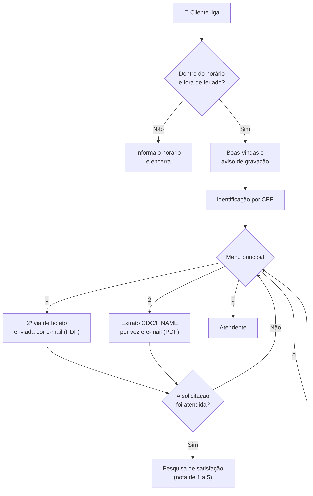
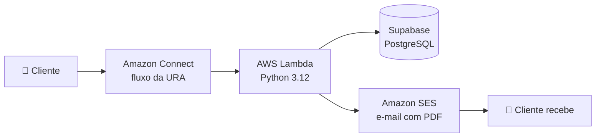

# 📞 URA Financeira Demo

Uma URA (atendimento telefônico automatizado) para o setor financeiro, construída na nuvem com **Amazon Connect**, **AWS Lambda**, **Supabase** e **Amazon SES**.

Projeto de demonstração da **Modo Piloto Consultoria de Tecnologia**, criado para mostrar como um atendimento por voz moderno pode resolver pedidos comuns de um cliente de financiamento sem precisar de um atendente.

> Todos os dados, nomes, CPFs e contratos deste projeto são **fictícios**.

---

## 🎧 A experiência do cliente

O cliente liga, informa o CPF e escolhe o que precisa. Ele pode pedir a segunda via do boleto, ouvir o extrato do financiamento ou falar com uma pessoa.



---

## ✨ Destaques

- **Horário de atendimento e feriados:** a URA confere se a central está aberta, com fuso de São Paulo e feriados cadastrados. Fora do horário, informa o expediente e encerra.
- **2ª via de boleto por e-mail:** o cliente recebe o boleto em PDF no e-mail cadastrado.
- **Extrato de financiamento (CDC e FINAME):** com um contrato, a URA fala os dados dele. Com vários, envia o extrato de todos em um PDF único, para o cliente não precisar digitar números de contrato.
- **Menu inteligente:** a opção 0 repete o menu até 3 vezes e depois encaminha para um atendente, para que o cliente nunca fique preso em um ciclo.
- **Pergunta "foi atendida?" e pesquisa de satisfação:** módulo reutilizável que mede se o autoatendimento resolveu e grava a nota no registro da ligação.

---

## 🏗️ Arquitetura



| Camada | Tecnologia | Papel |
|---|---|---|
| Atendimento por voz | Amazon Connect | Fluxo da URA, menu, horário, fila e pesquisa |
| Regras de negócio | AWS Lambda (Python 3.12) | Busca de cliente, boleto e extrato |
| Dados | Supabase (PostgreSQL) | Clientes, contratos e parcelas |
| E-mail | Amazon SES | Envio dos PDFs |

---

## 🧠 Decisões técnicas

- **Lambdas sem bibliotecas externas.** O acesso ao Supabase usa só a biblioteca padrão do Python, e o PDF do boleto e do extrato é montado no próprio código. Isso deixa o deploy simples e sem dependências para manter.
- **Horário e feriados sem código.** A checagem usa os recursos nativos do Amazon Connect (*hours of operation* com exceções para feriados), sem Lambda.
- **Dados que sobrevivem entre as etapas.** O Connect sobrescreve o resultado de cada Lambda a cada chamada, então os dados importantes, como o CPF, são copiados para atributos do contato.
- **Respostas prontas para falar.** A Lambda devolve a frase já montada, e o fluxo só fala. Assim as regras ficam no código e o fluxo fica simples.
- **Módulo de fluxo reutilizável.** A pergunta de resolução e a pesquisa de satisfação ficam em um módulo único, chamado pelos caminhos do boleto e do extrato.
- **Segurança desde o início.** Chaves ficam em variáveis de ambiente, o banco usa Row Level Security, e o repositório não contém chaves, IDs de conta nem telefone.

---

## 🚦 Status do projeto

- ✅ Horário de atendimento e feriados
- ✅ Identificação por CPF
- ✅ Menu principal com repetição limitada
- ✅ 2ª via de boleto por e-mail
- ✅ Extrato de financiamento (CDC e FINAME)
- ✅ Pergunta "foi atendida?" e pesquisa de satisfação
- ✅ Aviso de gravação (a gravação em si ainda será configurada)
- 🔜 Fila de atendimento completa, com música e mensagens de espera
- 🔜 Retorno de ligação (callback)

---

## 📁 Estrutura do repositório

```
ura-financeira-demo/
├── connect/     → fluxo do Amazon Connect (exportado e sem dados da conta)
├── database/    → scripts SQL do banco
└── lambdas/     → funções Lambda em Python
    ├── buscarCliente/
    ├── enviarBoleto/
    └── consultarExtrato/
```

---

## 👩‍💻 Autoria

Desenvolvido por **Dayane Pereira Costa**, estudante de Análise e Desenvolvimento de Sistemas, em projeto de demonstração da **Modo Piloto Consultoria de Tecnologia**.
