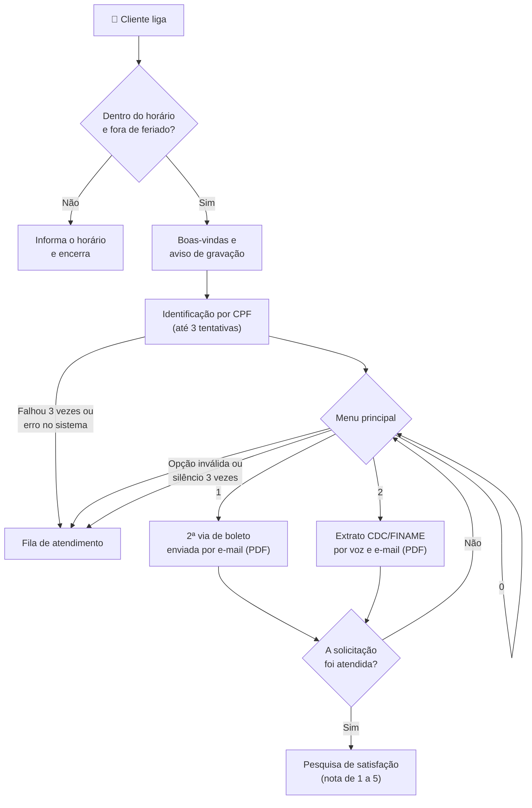
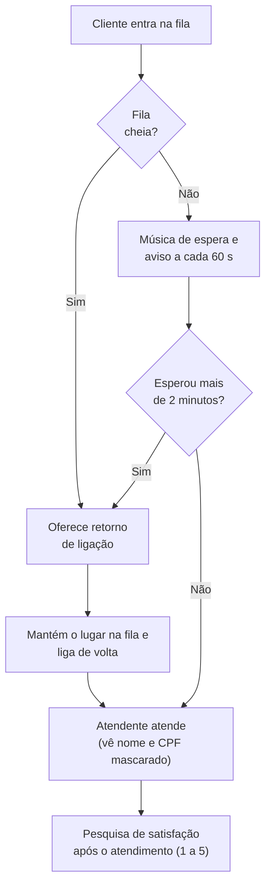
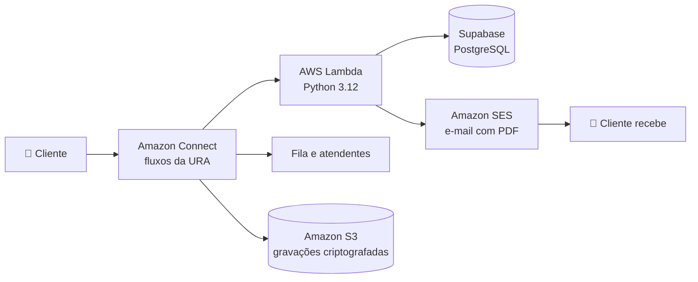

# 📞 URA Financeira Demo

Uma URA (atendimento telefônico automatizado) para o setor financeiro, construída na nuvem com **Amazon Connect**, **AWS Lambda**, **Supabase** e **Amazon SES**.

Projeto de demonstração da **Modo Piloto Consultoria de Tecnologia**, criado para mostrar como um atendimento por voz moderno pode resolver pedidos comuns de um cliente de financiamento sem precisar de um atendente, e como encaminhar para uma pessoa, com contexto, quando for necessário.

> Todos os dados, nomes, CPFs e contratos deste projeto são **fictícios**.

---

## 🎧 A experiência do cliente

O cliente liga, informa o CPF e escolhe o que precisa. Ele pode pedir a segunda via do boleto, ouvir o extrato do financiamento ou falar com uma pessoa.

### Autoatendimento



### Fila e atendimento humano



---

## ✨ Destaques

- **Horário de atendimento e feriados:** a URA confere se a central está aberta, com fuso de São Paulo e feriados cadastrados. Fora do horário, informa o expediente e encerra.
- **Identificação por CPF com proteção:** o CPF é validado antes de consultar o banco, e depois de 3 tentativas erradas, ou se o sistema falhar, o cliente é encaminhado a um atendente em vez de ficar preso.
- **2ª via de boleto por e-mail:** o cliente recebe o boleto em PDF no e-mail cadastrado.
- **Extrato de financiamento (CDC e FINAME):** com um contrato, a URA fala os dados dele. Com vários, envia o extrato de todos em um PDF único, para o cliente não precisar digitar números de contrato.
- **Menu que nunca prende o cliente:** a opção 0 repete o menu até 3 vezes, e opção inválida ou silêncio também têm limite de 3 tentativas. Depois disso, a ligação vai para um atendente.
- **Fila de espera com experiência cuidada:** música, aviso periódico a cada 60 segundos e, depois de 2 minutos, oferta de **retorno de ligação** mantendo o lugar na fila. Se a fila estiver cheia, o retorno também é oferecido.
- **Contexto para o atendente:** quando a ligação chega, o painel mostra o **nome** do cliente e o **CPF mascarado** (ex.: `***.456.789-**`).
- **Gravação com controle de acesso:** o aviso de gravação toca no início, a gravação fica em bucket S3 com criptografia, e só o perfil de supervisor acessa.
- **Pesquisa de satisfação em dois momentos:** depois do autoatendimento ("a solicitação foi atendida?") e depois do atendimento humano (nota de 1 a 5, com uma nova tentativa e registro de "sem resposta"). As notas ficam gravadas no registro de cada ligação.

---

## 🏗️ Arquitetura



| Camada | Tecnologia | Papel |
|---|---|---|
| Atendimento por voz | Amazon Connect | Fluxos da URA, menu, horário, fila, callback, gravação e pesquisas |
| Regras de negócio | AWS Lambda (Python 3.12) | Busca de cliente, boleto e extrato |
| Dados | Supabase (PostgreSQL) | Clientes, contratos e parcelas |
| E-mail | Amazon SES | Envio dos PDFs |
| Gravações | Amazon S3 + KMS | Armazenamento criptografado, acesso só para supervisor |

### Fluxos do Amazon Connect

| Fluxo | Função |
|---|---|
| `DEMO_ModoPiloto_Day` | Fluxo principal: horário, CPF, menu, boleto, extrato e encaminhamento |
| `Fila_Espera_ModoPiloto` | Fluxo da fila: música, avisos e oferta de retorno de ligação |
| `Pesquisa_Pos_Atendimento` | Pesquisa de satisfação executada depois que o atendente desliga |

---

## 🧠 Decisões técnicas

- **Lambdas sem bibliotecas externas.** O acesso ao Supabase usa só a biblioteca padrão do Python, e o PDF do boleto e do extrato é montado no próprio código. Isso deixa o deploy simples e sem dependências para manter.
- **Horário e feriados sem código.** A checagem usa os recursos nativos do Amazon Connect (*hours of operation* com exceções para feriados), sem Lambda.
- **Dados que sobrevivem entre as etapas.** O Connect sobrescreve o resultado de cada Lambda a cada chamada, então os dados importantes, como CPF e nome, são copiados para atributos do contato logo depois.
- **Respostas prontas para falar.** A Lambda devolve a frase já montada, e o fluxo só fala. Assim as regras ficam no código e o fluxo fica simples.
- **Limites de tentativa em todo lugar.** Contadores (blocos *Loop*) impedem que CPF inválido, opção inválida ou silêncio prendam o cliente em um ciclo. O destino final é sempre uma pessoa.
- **Fila com fluxo próprio.** A espera, os avisos e o retorno de ligação ficam em um fluxo dedicado, separado do fluxo principal, o que facilita ajustar tempos e mensagens.
- **Privacidade por padrão.** O atendente vê apenas o CPF mascarado, os logs das Lambdas não registram dados pessoais, e as gravações ficam criptografadas com acesso restrito. Em produção, o CPF completo também deve usar atributos restritos ao fluxo.
- **Segurança desde o início.** Chaves ficam em variáveis de ambiente, o banco usa Row Level Security, e o repositório não contém chaves, IDs de conta nem telefone.

---

## 🚦 Status do projeto

- ✅ Horário de atendimento e feriados
- ✅ Identificação por CPF, com limite de tentativas
- ✅ Menu principal com repetição limitada e tratamento de erro e silêncio
- ✅ 2ª via de boleto por e-mail
- ✅ Extrato de financiamento (CDC e FINAME)
- ✅ Pergunta "foi atendida?" e pesquisa de satisfação
- ✅ Fila de atendimento com música, avisos e retorno de ligação 
- ✅ Gravação com acesso restrito a supervisor 
- ✅ Pesquisa de satisfação após o atendimento humano

---

## 📁 Estrutura do repositório

```
ura-financeira-demo/
├── connect/     → fluxos do Amazon Connect (exportados e sem dados da conta)
├── database/    → scripts SQL do banco
└── lambdas/     → funções Lambda em Python
    ├── buscarCliente/
    ├── enviarBoleto/
    └── consultarExtrato/
```

---

## 👩‍💻 Autoria

Desenvolvido por **Dayane Pereira Costa**, estudante de Análise e Desenvolvimento de Sistemas, em projeto de demonstração da **Modo Piloto Consultoria de Tecnologia**.
