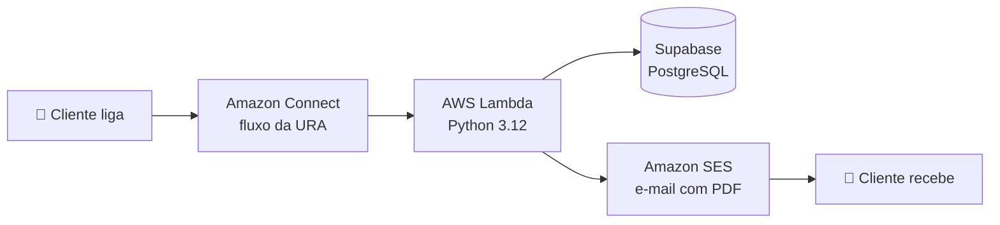

# 📞 URA Financeira Demo

Demonstração de atendimento telefônico automatizado (URA) para o setor financeiro, construída com **Amazon Connect**, **AWS Lambda**, **Supabase** e **Amazon SES**.

Projeto da **Modo Piloto Consultoria de Tecnologia** para apresentar soluções de atendimento em nuvem a empresas do setor financeiro.

> ⚠️ Todos os dados, nomes, CPFs e contratos deste repositório são **fictícios**.

---

## ✨ O que a demo faz

O cliente liga, informa o CPF e escolhe uma opção no menu de voz:

| Opção | Funcionalidade | Função Lambda |
|:---:|---|---|
| 1 | Envio de segunda via de boleto por e-mail (PDF) | `enviarBoleto` |
| 2 | Extrato de financiamento (CDC ou FINAME) por voz e por e-mail (PDF) | `consultarExtrato` |

Antes de qualquer opção, o CPF é validado e o cliente é identificado pela função `buscarCliente`.

**Extrato de financiamento:** com um contrato, a URA fala os dados dele. Com vários contratos, envia o extrato de todos para o e-mail cadastrado, sem exigir que o cliente digite números de contrato.

---

## 🏗️ Arquitetura



---

## 📁 Estrutura do repositório

```
ura-financeira-demo/
├── connect/     → fluxo do Amazon Connect (JSON, sem dados da conta)
├── database/    → scripts SQL do banco (rodar em ordem)
│   ├── 01_banco_demo.sql
│   └── 02_extrato_modalidade.sql
└── lambdas/     → funções Lambda em Python
    ├── buscarCliente/
    ├── enviarBoleto/
    └── consultarExtrato/
```

---

## 🛠️ Tecnologias

- **Amazon Connect**: fluxo de atendimento por voz
- **AWS Lambda** (Python 3.12): regras de negócio, sem bibliotecas externas
- **Supabase** (PostgreSQL): clientes, contratos e parcelas
- **Amazon SES**: envio de e-mails com PDF anexo
- **Geração de PDF**: feita no próprio código, sem dependências

---

## 🗄️ Banco de dados

Três tabelas: `clientes`, `contratos` (modalidade CDC ou FINAME) e `parcelas`.

Rode os scripts de `database/` no **SQL Editor** do Supabase, **uma vez**, nesta ordem:

1. `01_banco_demo.sql`
2. `02_extrato_modalidade.sql`

---

## ⚙️ Configuração

### Variáveis de ambiente das Lambdas

| Variável | Descrição |
|---|---|
| `SUPABASE_URL` | Endereço do projeto Supabase |
| `SUPABASE_SECRET_KEY` | Chave secreta do Supabase |
| `EMAIL_REMETENTE` | E-mail remetente verificado no SES |
| `NOME_EMPRESA` | (opcional) Nome exibido nos documentos |

> 🔒 **Nunca** coloque chaves reais neste repositório. Elas ficam apenas nas variáveis de ambiente da Lambda.

### Amazon Connect

1. Importe o fluxo de `connect/` (e troque os ARNs das Lambdas e filas pelos da sua conta).
2. Em cada bloco **AWS Lambda**, configure o parâmetro de entrada: chave `cpf`, **Set dynamically**, namespace **User defined**, atributo `cpf`.

### Amazon SES

A conta SES em modo sandbox só envia para e-mails **verificados**. Verifique o remetente e os e-mails de teste.

---

## 🧪 Como testar

Use os clientes fictícios do banco de demonstração, por exemplo:

- **Um contrato:** Carla Menezes Duarte (CPF `52998224725`)
- **Três contratos (CDC e FINAME):** Roberto Almeida Pires (CPF `11144477735`)

---

## 🗺️ Próximos passos

- [ ] Consulta de parcelas em aberto
- [ ] Novas opções no menu da URA
- [ ] Ambiente de produção

---

## 👩‍💻 Autoria

Desenvolvido por **Dayane Pereira Costa**, estudante de Análise e Desenvolvimento de Sistemas, em projeto de demonstração da **Modo Piloto Consultoria de Tecnologia**.
